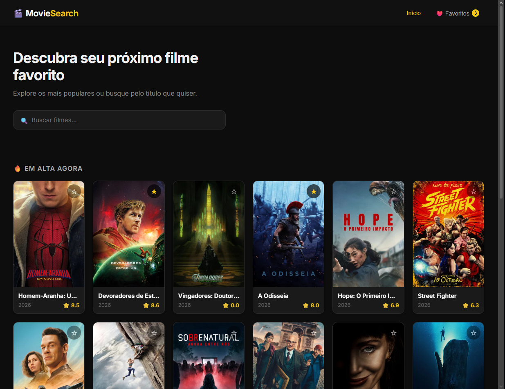
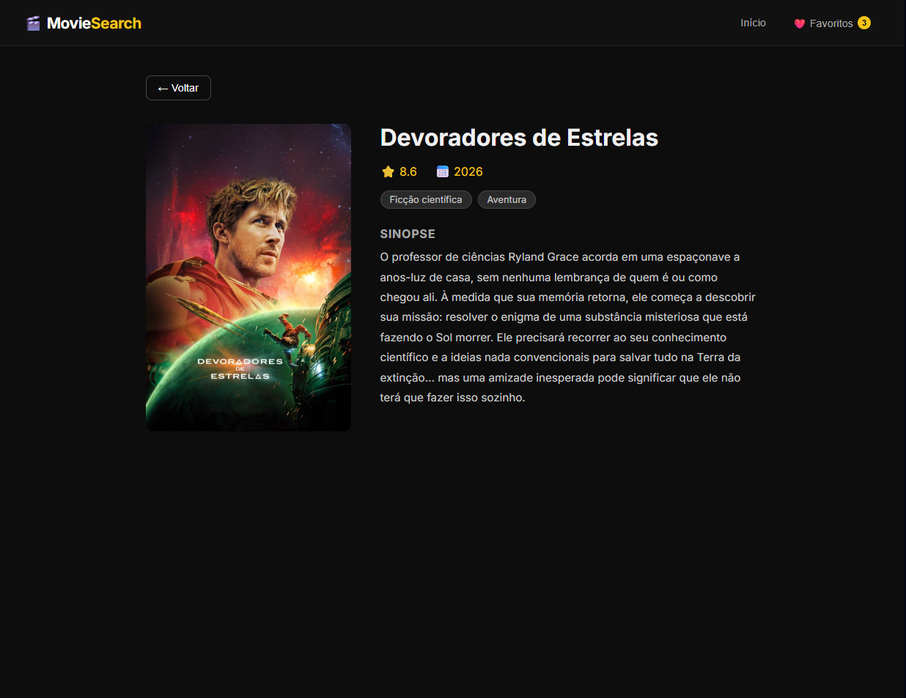
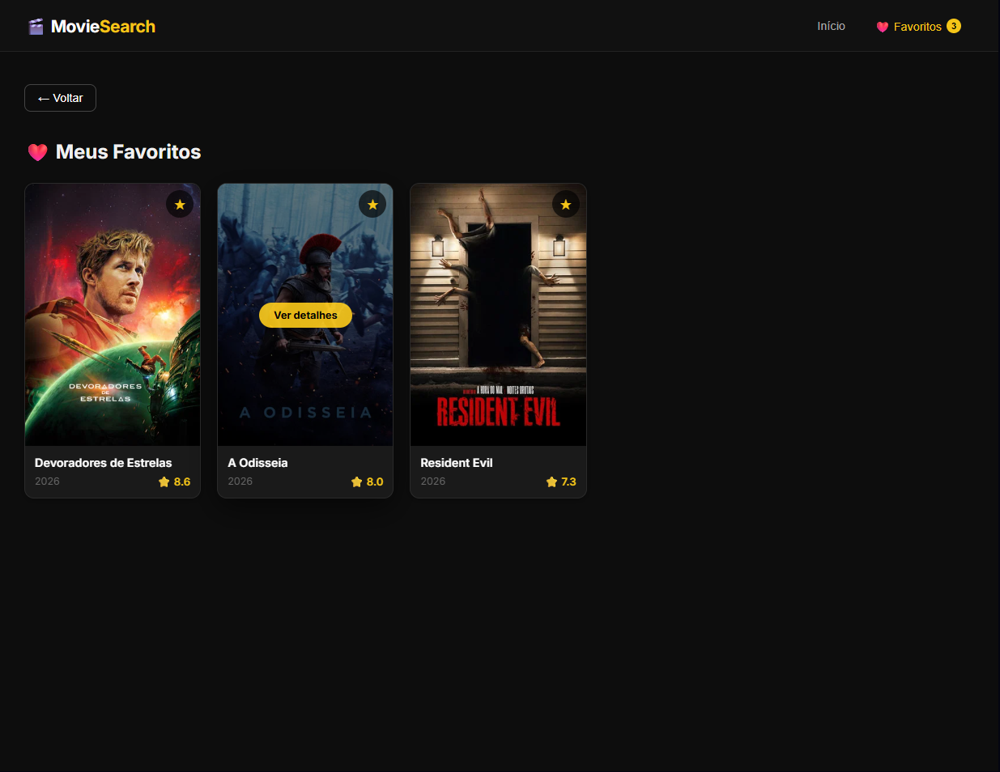

# 🎬 Movie Search App

Aplicação web para busca e descoberta de filmes, desenvolvida em React com dados da API do TMDB.

[](https://react.dev)
[](https://reactrouter.com)
[](https://www.themoviedb.org/documentation/api)
[](https://movie-search-app-gtv5.vercel.app)

🔗 **Demo online:** [movie-search-app-gtv5.vercel.app](https://movie-search-app-gtv5.vercel.app)

---

## 📸 Screenshots

| Home | Detalhes do filme | Favoritos |
| :---: | :---: | :---: |
|  |  |  |

---

## ✨ Funcionalidades

- 🔥 Listagem de filmes populares
- 🔍 Busca de filmes em tempo real
- 🎬 Página de detalhes com sinopse, gêneros e avaliação
- ❤️ Sistema de favoritos com persistência no `localStorage`
- ⚡ Indicador de carregamento e tratamento de erros

---

## 🛠️ Tecnologias

- **Interface:** React 19 e React Icons
- **Navegação:** React Router DOM 7
- **Build:** Create React App (react-scripts)
- **Dados:** [TMDB API](https://www.themoviedb.org/documentation/api)
- **Deploy:** Vercel

---

## 📁 Estrutura de pastas

```
src/
├── components/   # Navbar, MovieCard, SearchBar, Loading, ErrorMessage
├── pages/        # Home, MovieDetail, Favorites
├── context/      # Estado global dos favoritos
└── services/     # Comunicação com a API do TMDB
```

---

## 🚀 Como rodar localmente

**Pré-requisitos:** Node.js instalado e uma chave gratuita da API do [TMDB](https://www.themoviedb.org/settings/api).

1. Clone o repositório:

```bash
git clone https://github.com/g4bri3llucas/Movie-Search-App.git
cd Movie-Search-App
```

2. Instale as dependências:

```bash
npm install
```

3. Configure a chave da API. Copie o arquivo de exemplo:

```bash
cp .env.example .env
```

Depois edite o `.env` e coloque a sua chave:

```
REACT_APP_TMDB_KEY=sua_chave_aqui
```

4. Inicie o projeto:

```bash
npm start
```

O app abre em [http://localhost:3000](http://localhost:3000).

---

## 📦 Build para produção

```bash
npm run build
```

---

## 📝 Licença

Distribuído sob a licença MIT. Veja o arquivo [LICENSE](LICENSE).

---

## 👤 Autor

Desenvolvido por **Gabriel Lucas** · [GitHub](https://github.com/g4bri3llucas)

*Este produto usa a API do TMDB, mas não é endossado nem certificado pelo TMDB.*